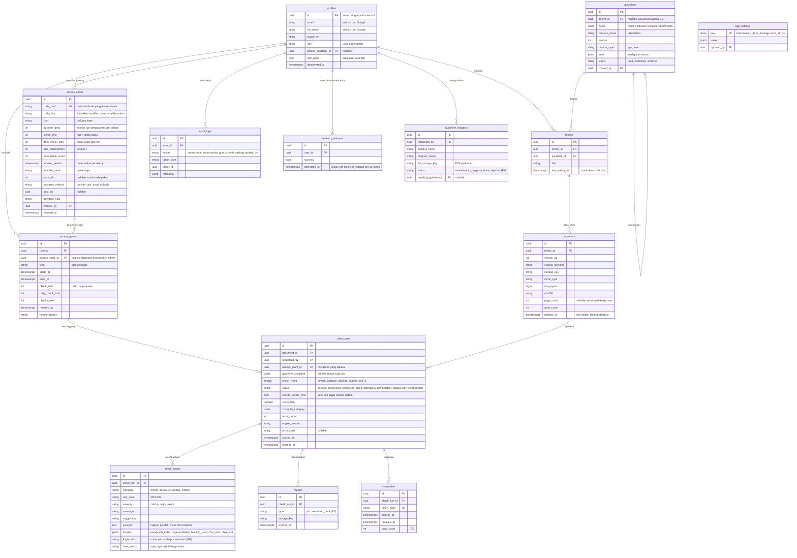

# ERD: Skrippy

Versi 0.4 (tanpa VPS, pemeriksaan berjalan di Vercel Functions). Database: PostgreSQL di Supabase. Autentikasi memakai Supabase Auth (Google), sehingga data login ada di skema `auth` milik Supabase. Semua tabel aplikasi berada di skema `public`. Semua primary key memakai UUID v7 (urut waktu). Semua tabel punya `created_at` dan `updated_at` (timestamptz), tidak ditulis ulang di diagram agar ringkas.

Kolom atau tabel bertanda **(F2)** dan **(F3)** baru dipakai di fase tersebut, tapi boleh dibuat sejak awal agar migrasi lebih sederhana.

**Perubahan dari v0.1:** tabel institusi, prodi, lisensi, bimbingan dosen, paket kredit, order, event pembayaran, dan buku besar kredit dihapus. Diganti dengan `access_codes`, `access_grants`, dan `app_settings`.

## Diagram



## Penjelasan tabel

### Pengguna
- **auth.users** (milik Supabase, tidak dikelola aplikasi): dibuat otomatis oleh Supabase saat seseorang masuk dengan Google.
- **profiles**: data aplikasi per pengguna, dengan `id` yang sama dengan `auth.users.id` (FK `ON DELETE CASCADE`). **Profil dibuat otomatis pada panggilan API pertama setelah masuk.** Bila `trial.enabled = 1`, profil langsung mendapat satu grant trial (nilai disalin dari `app_settings`, `trial_used = true`); akun lama yang belum punya grant apa pun mendapat trial saat masuk berikutnya. Bila trial mati, profil dibuat tanpa grant (`trial_used = false`) dan menunggu kode paket. Kode akses hanya untuk paket. Superadmin (email di `SUPERADMIN_EMAIL`) mendapat profil otomatis dengan grant paket tanpa batas. Dua peran saja, `user` dan `superadmin` (di UI disebut Pengguna dan Admin). Admin bisa mengubah peran akun lain dari panel Pengguna (modal "Atur akun"), dicatat di `audit_logs` sebagai `user.role_change`. Pengaman: tidak bisa mengubah akun sendiri, akun pemilik (`SUPERADMIN_EMAIL`) tidak bisa diubah, dan harus tersisa minimal satu admin. `trial_used` mencegah satu akun mendapat trial dua kali.
  Admin juga bisa memberi akses langsung dari modal "Kelola pengguna": selamanya (grant paket 100 tahun, tanpa kode) atau trial N hari, dan mencabut akses (`user.role_change`, `grant.lifetime`, `grant.trial`, `grant.stop` di `audit_logs`). Admin boleh menghapus akun pengguna lain termasuk admin lain, kecuali akun sendiri dan akun pemilik.
- Akun di `auth.users` yang tidak punya profil setelah 7 hari dihapus oleh job terjadwal, agar tidak menumpuk akun asing yang sekadar mencoba masuk.

### Akses
- **access_codes**: kode yang dibuat pemilik. **Kode asli tidak disimpan**, hanya hash-nya (seperti kata sandi), sehingga kebocoran database tidak membocorkan kode yang belum dipakai. Kode asli hanya ditampilkan sekali saat dibuat, lengkap dengan pesan siap kirim. `code_hint` membantu pemilik mengenali kode di daftar.
  - `duration_days` disalin dari `app_settings` saat kode dibuat (masa akses). `check_limit` dan `daily_check_limit` di kode tidak lagi dipakai saat penukaran: batas cek dibaca dari `app_settings` saat grant dibuat, dan `updateSettings` memperbarui grant aktif (bukan admin) ketika batas diubah.
  - Kolom pembayaran (`price_idr`, `payment_method`, `paid_on`, `payment_note`) adalah catatan pembukuan manual untuk kode paket.
- **access_grants**: hak akses yang aktif atau pernah aktif milik pengguna. Satu penukaran kode menghasilkan satu grant. Grant juga bisa dibuat manual oleh admin (misal memberi bonus), dengan `access_code_id` kosong dan tercatat di `audit_logs`.
- **app_settings**: nilai yang bisa diubah dari panel admin tanpa deploy ulang.

Contoh isi `app_settings`:

| key | value |
|---|---|
| `trial.duration_days` | `7` |
| `trial.check_limit` | `3` |
| `package.name` | `"Paket Skripsi"` |
| `package.price_idr` | `25000` |
| `package.duration_days` | `30` |
| `package.daily_check_limit` | `20` |
| `code.redeem_window_days` | `14` |
| `contact.whatsapp` | `"62812xxxxxxx"` (untuk tombol "Hubungi pemilik") |

### Pedoman
- **guidelines**: aturan pemeriksaan dalam kolom `rules` (jsonb). Pedoman yang sudah `published` tidak diubah. Perubahan membuat baris baru dengan `version` + 1.
- **guideline_requests** (F2): usulan pedoman dari pengguna beserta PDF pedoman kampusnya.

Contoh isi `rules`:

```json
{
  "page": { "size": "A4", "margins_cm": { "left": 4, "top": 4, "right": 3, "bottom": 3 } },
  "body": { "font_family": "Times New Roman", "font_size_pt": 12, "line_spacing": 2.0, "first_line_indent_cm": 1.25, "alignment": "justify" },
  "chapter_heading": { "pattern": "^BAB [IVX]+$", "uppercase": true, "alignment": "center", "bold": true },
  "page_numbering": { "front_matter": "lower_roman", "body": "arabic", "body_starts_at": "BAB I" },
  "captions": { "table_position": "above", "figure_position": "below", "numbering": "chapter.sequence" },
  "required_sections": ["HALAMAN JUDUL", "LEMBAR PENGESAHAN", "ABSTRAK", "KATA PENGANTAR", "DAFTAR ISI", "BAB I", "BAB II", "BAB III", "BAB IV", "BAB V", "DAFTAR PUSTAKA"],
  "abstract_words": { "min": 150, "max": 300 },
  "citation": { "style": "apa", "max_source_age_years": 10, "max_old_source_ratio": 0.3 },
  "severity_weights": { "critical": 10, "major": 3, "minor": 1 },
  "disabled_rules": []
}
```

### Naskah dan pemeriksaan
- **theses**: wadah satu skripsi dengan beberapa versi naskah.
- **documents**: setiap unggahan adalah versi baru. `sha256` mendeteksi unggahan file yang sama persis, sehingga sistem bisa menawarkan membuka hasil cek lama alih-alih memakai jatah lagi.
- **check_runs**: satu kali pemeriksaan. `access_grant_id` mencatat hak akses mana yang dipakai. `counts_toward_limit` bernilai false bila cek gagal karena kesalahan sistem.
- **check_issues**: satu temuan. `fingerprint` dipakai untuk mencocokkan temuan antarversi.
- PDF dan .docx naskah bersorot (F2) dibuat sesuai permintaan dari data yang ada, tidak disimpan (tidak ada tabel `reports`).
- **code_batches**: satu batch = sekumpulan kode yang dibuat bersamaan (`number` berurutan untuk tampilan "Batch N", `note`). `access_codes.batch_id` kosong untuk kode lama; di UI muncul sebagai kelompok "Kode lama". Mencabut batch menghapus semua kodenya dan mencabut akses yang berasal darinya.
- `access_codes.code_encrypted`: kode asli terenkripsi AES-GCM agar admin bisa melihatnya lagi (null untuk kode lama). `max_redemptions` adalah kuota pakai per kode (orang berbeda; orang yang sama tidak bisa memakai kode yang sama dua kali). `redeem_before` yang sangat jauh (100 tahun) berarti tanpa batas waktu.
- **share_links** (F2): tautan baca saja untuk membagikan laporan ke dosen atau teman. Token 256 bit hanya dikembalikan sekali, yang disimpan HMAC-nya. Berlaku 14 hari, bisa dicabut (`revoked_at`), maksimal 5 aktif per laporan.
- **integration_secrets** (F3): kunci API penyedia AI, terenkripsi AES-GCM dengan kunci turunan `ACCESS_CODE_HMAC_SECRET`. `hint` menyimpan 4 karakter terakhir untuk ditampilkan. Tidak pernah dikembalikan ke browser.
- `dictionary_entries` (id, kind `nonstandard` atau `foreign`, term, replacement, created_by): kamus tambahan admin untuk EJA-001 dan EJA-006. Unik per (kind, term). Disalin ke `guideline_snapshot.dictionary` saat cek dibuat, jadi perubahan kamus tidak memengaruhi cek yang sudah ada.
- `ignored_findings` (id, user_id, rule_code, text): temuan yang selalu diabaikan pengguna ("Abaikan selalu"). Unik per (user_id, rule_code, text), terhapus bersama akun (cascade). Dipakai menyaring temuan saat cek dijalankan.
- `ai_slots` (key, holder, locked_until): satu baris sebagai kunci giliran analisis AI lintas instance server. Kunci kedaluwarsa sendiri lewat `locked_until` bila pemegangnya mati.
- `check_issues.user_status` bernilai open, ignored, false_positive, atau done (ditandai pengguna sudah diperbaiki; tidak masuk PDF dan docx bersorot).
- `check_runs.stats` (jsonb, boleh kosong pada cek lama): statistik naskah (kata per bab, sitasi per bab, keterbacaan, umur sumber) dari `checkers/stats.ts`. Bukan temuan dan tidak memengaruhi skor.
- Aturan yang dimatikan pengguna untuk satu cek (`skip_rules`) digabung ke `guideline_snapshot.disabled_rules` milik cek itu; pedoman aslinya tidak berubah.
- Salinan PDF laporan disimpan di Storage sebagai `<storage_key>.<check_run_id>.report.pdf` (tanpa kolom DB). Dibuang saat status temuan berubah dan ikut dihapus bersama naskah (`deleteDocument`).
- `check_runs.ai_status` (completed, partial, failed, kosong bila AI tidak diminta) dan `ai_note`: kegagalan AI dicatat di sini tanpa menggagalkan cek aturan. `check_issues.category = 'ai'` untuk temuan AI (AI-001 tata bahasa, AI-002 konsistensi antarbab, AI-003 kalimat tidak efektif, AI-004 kalimat ambigu, AI-005 klaim tanpa sitasi, AI-006 kualitas abstrak, AI-007 kesesuaian tujuan, metode, dan hasil).
- `access_grants.reminder_sent_at`: penanda pengingat email sudah terkirim (sekali per akses).

### Lainnya
- **redeem_attempts**: catatan percobaan penukaran kode, dipakai untuk rate limit karena tidak ada Redis. Baris lebih dari 7 hari dihapus oleh job harian.
- **audit_logs**: tindakan admin (buat dan cabut kode, perpanjang atau hentikan akses, ubah pengaturan, ubah pedoman).

## Logika akses

**Menentukan akses aktif:** grant milik pengguna dengan `revoked_at IS NULL` dan `now() BETWEEN starts_at AND ends_at`. Bila ada beberapa, pakai yang `ends_at` paling akhir. Paket diprioritaskan di atas trial.

**Bisa menjalankan cek bila:**
1. Ada grant aktif, dan
2. `check_limit` null atau `checks_used < check_limit`, dan
3. Jumlah `check_runs` pengguna hari ini (WIB) dengan `counts_toward_limit = true` kurang dari `daily_check_limit`.

**Menukar kode** (dalam satu transaksi, dengan `SELECT ... FOR UPDATE` pada baris kode dan pengguna):
1. Normalisasi input (huruf kapital, buang spasi dan tanda hubung), hitung hash, cari kode.
2. Tolak bila tidak ditemukan, dicabut, lewat `redeem_before`, atau `redemption_count >= max_redemptions`. Pesan error dibuat sama untuk semua kasus agar tidak membocorkan informasi.
3. Kode trial: tolak bila `profiles.trial_used = true`. Bila diterima, set `trial_used = true`.
4. Hitung `starts_at` dan `ends_at`:
   - Trial: mulai sekarang, berakhir sekarang + `duration_days`.
   - Paket, dan pengguna punya paket aktif: `ends_at` = `ends_at` paket aktif + `duration_days` (diperpanjang).
   - Paket, tanpa paket aktif: mulai sekarang. Bila ada trial aktif, trial diakhiri (`revoked_at` diisi, alasan "upgrade").
5. Buat `access_grants`, tambah `redemption_count`.

**Menjalankan cek** (satu transaksi): periksa syarat di atas, buat `check_runs`, tambah `access_grants.checks_used`. Bila cek gagal karena sistem, set `counts_toward_limit = false` dan kurangi `checks_used`.

## Indeks dan batasan penting

| Tabel | Indeks atau batasan |
|---|---|
| profiles | PK `id` = FK ke `auth.users(id) ON DELETE CASCADE`, indeks `(lower(email))` |
| access_codes | `UNIQUE (code_hash)`, `CHECK (redemption_count <= max_redemptions)` |
| access_grants | indeks `(user_id, ends_at DESC)`, `CHECK (check_limit IS NULL OR checks_used <= check_limit)` |
| guidelines | `UNIQUE (name, version)` |
| documents | `UNIQUE (thesis_id, version_no)` |
| check_runs | indeks `(requested_by, created_at)` untuk batas harian, indeks `(document_id, created_at DESC)` |
| check_issues | indeks `(check_run_id, category, severity)`, indeks `(check_run_id, fingerprint)` |
| share_links | `UNIQUE (token_hash)` |
| theses | indeks `(last_activity_at)` untuk job retensi |
| check_runs | indeks parsial `WHERE status IN ('queued','processing')` untuk job yang membersihkan cek macet |

## Pemeriksaan tanpa antrean

Tidak ada Celery atau Redis. Alurnya:

1. Browser meminta signed upload URL ke API, mengunggah .docx langsung ke Supabase Storage (batas body function 4,5 MB, jadi file tidak boleh lewat function).
2. Browser memanggil API membuat `check_runs` (status `queued`). API memeriksa hak akses dan mencatat pemakaian jatah dalam satu transaksi.
3. Function yang sama (atau function kedua yang dipanggil klien) mengunduh file, mem-parse, menjalankan checker, menulis `check_issues`, lalu mengisi skor dan status `completed`.
4. Browser polling `check_runs.status` untuk stepper.
5. Job harian menandai `check_runs` berstatus `processing` lebih dari 10 menit sebagai `failed` (error_code `timeout`), dan mengembalikan jatahnya.

## Aturan integritas data

1. Kode akses asli tidak pernah disimpan atau di-log. Hanya hash dan 4 karakter terakhir.
2. Perubahan akses (tukar kode, perpanjang manual, hentikan) selalu membuat atau mengubah `access_grants` di dalam transaksi, dan tindakan admin tercatat di `audit_logs`.
3. Penghapusan dokumen: isi `deleted_at`, hapus file fisik, kosongkan `excerpt` pada `check_issues` terkait.
4. Pedoman `published` tidak pernah diubah.
5. Hapus akun: hapus semua file dan data pribadi. Catatan pembayaran di `access_codes` tetap disimpan tanpa tautan ke identitas pengguna.
